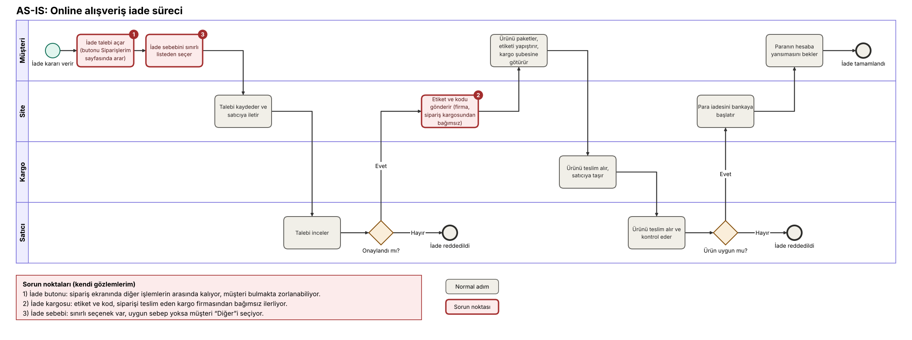

# İade Süreci İyileştirme: İş Analizi Vaka Çalışması

Yönetim Bilişim Sistemleri son sınıf öğrencisiyim ([DOLDUR: Ad Soyad], [DOLDUR: LinkedIn bağlantısı]). Bu depo, iş analistliği alanındaki ilk uçtan uca çalışmamı içeriyor. Bir online alışveriş sitesinin iade sürecini müşteri gözüyle inceledim, sorunları belirledim ve bunları süreç şemasına, gereksinim dokümanına ve Agile backlog'a dönüştürdüm.

Bu bir öğrenci projesi. Gerçek bir şirketin verisine erişimim olmadı, As-Is bilgisi dışarıdan yaptığım gözlemlere dayanıyor. Hedef değerler ölçüm değil, tahmin.

[DOLDUR: ilgi alanını bir iki cümleyle yaz, örneğin turizm veya e-ticaret]

## İncelediğim sorunlar

Süreci baştan sona gezerken üç şey dikkatimi çekti:

1. İade butonu sipariş ekranında diğer işlemlerin arasında kalıyor.
2. İade kargosu, siparişi teslim eden firmayla aynı akışta ilerlemiyor.
3. İade sebebi seçenekleri sınırlı, müşteri çoğu zaman "Diğer"i seçiyor.

## As-Is şeması



Şemayı draw.io ile çizdim ([iade_sureci_as_is.drawio](01-surec-analizi/iade_sureci_as_is.drawio)). Kırmızı kutular sorun noktalarını gösteriyor.

## Nasıl ilerledim

Önce [DOLDUR: site adı] sitesinin iade akışını baştan sona gezip her adımı not aldım. [DOLDUR: varsa kaç kişiyle görüştüğünü veya anket yaptığını yaz, yoksa bu cümleyi sil] Notlardan Müşteri, Site, Kargo ve Satıcı şeritli bir As-Is şeması çizdim. Her bulgu için önerdiğim durumu ve beklediğim faydayı bir As-Is / To-Be tablosunda karşılaştırdım.

Ardından ölçütleri belirledim: iade butonuna tıklama sayısı, talep açma süresi, "Diğer" sebep oranı ve iade kargosu destek yoğunluğu. Her biri için As-Is ölçümü ve To-Be hedefi var, ölçülemeyenleri tahmin olarak işaretledim.

Bulgulardan bir BRD yazdım: iş, işlevsel ve işlevsel olmayan gereksinimler, MoSCoW önceliklendirmesi ve izlenebilirlik matrisi. Son olarak gereksinimleri 3 epic ve 11 kullanıcı hikayesine, kabul kriterleriyle birlikte, 3 sprintlik bir plana çevirdim.

## Çıktılar

| Çıktı | Açıklama | Dosya |
|---|---|---|
| As-Is şeması | 4 şeritli süreç şeması, 3 sorun noktası | [draw.io](01-surec-analizi/iade_sureci_as_is.drawio) · [PNG](01-surec-analizi/iade_sureci_as_is.png) |
| As-Is / To-Be tablosu | 3 bulgu, önerilen durum, beklenen fayda, ölçütler | [xlsx](01-surec-analizi/iade_sureci_as_is_to_be_tablo.xlsx) |
| BRD | 3 iş, 8 işlevsel, 5 işlevsel olmayan gereksinim, riskler | [BRD.md](02-gereksinimler/BRD.md) |
| Jira backlog | 3 epic, 11 iş kalemi, 3 sprint planı | [xlsx](02-gereksinimler/iade_jira_backlog.xlsx) · [csv](02-gereksinimler/iade_jira_backlog.csv) |
| İade süreci panosu | Ölçütler ve bulgular için etkileşimli pano | [index.html](03-pano/index.html) · Canlı: [DOLDUR: GitHub Pages bağlantısı] |
| ECBA hazırlık planı | 6 haftalık çalışma planı ve BACCM eşlemesi | [xlsx](04-ecba-hazirlik/ecba_calisma_plani.xlsx) |

[DOLDUR: Jira board ekran görüntüsünü 02-gereksinimler/jira-board.png olarak ekle ve buraya bağla, ya da bu satırı sil]

## Bulgular ve önerilerim

| Bulgu | Önerdiğim durum (To-Be) | Beklenen fayda |
|---|---|---|
| İade butonu diğer işlemlerin arasında kalıyor | Sipariş kartında ve detayında ayrı, belirgin bir "İade Et" butonu | Daha az tıklama, daha az destek başvurusu |
| İade kargosu farklı akışta ilerliyor | İade, siparişi teslim eden aynı firmayla devam eder, etiket ve kod otomatik oluşur | Daha az karışıklık, tek yerden takip |
| İade sebepleri sınırlı | Kategoriye göre ayrıntılı sebep ve alt sebep listesi | Doğru yönlendirme, analiz edilebilir sebep verisi |

## Ölçütler

| Gösterge | As-Is | To-Be hedefi (varsayım) |
|---|---|---|
| İade butonuna tıklama sayısı | [DOLDUR: ölçtüğün değer] | 2 veya altı |
| İade talebini açma süresi | [DOLDUR: ölçtüğün değer, saniye] | As-Is değerinin yaklaşık %70'i |
| "Diğer" sebebi oranı | [DOLDUR: tahmin] | Belirgin şekilde düşük |
| İade kargosu destek sorusu | [DOLDUR: Düşük / Orta / Yüksek] | Azalır |

## BACCM ile eşleştirme

ECBA'ya hazırlanırken projemi BACCM kavramlarıyla eşleştirdim:

| Kavram | Bu projedeki karşılığı |
|---|---|
| Change (Değişiklik) | Online alışveriş iade sürecinin iyileştirilmesi |
| Need (İhtiyaç) | İade talebini kolay başlatamama, iade kargosunda karışıklık, yetersiz sebep seçenekleri |
| Solution (Çözüm) | Ayrı "İade Et" butonu, aynı kargo firmasıyla iade, ayrıntılı sebep listesi |
| Stakeholder (Paydaş) | Müşteri, müşteri hizmetleri, ürün ve UX, yazılım, kargo firmaları, satıcılar, hukuk |
| Value (Değer) | Daha kısa iade süresi, daha az destek başvurusu, kullanılabilir sebep verisi (hedefler varsayım) |
| Context (Bağlam) | Cayma hakkı mevzuatı, rakip siteler, müşteri alışkanlıkları, kargo entegrasyon imkanları |

## Neler öğrendim, nerede sınırlıyım

- Gözlemden başlayıp bulguyu gereksinime, gereksinimi kullanıcı hikayesine ve kabul kriterine bağlayan izlenebilir bir zincir kurmayı öğrendim.
- Kargo firması entegrasyonunu en büyük risk olarak gördüm, bu yüzden backlog'a erken bir araştırma (spike) kalemi koydum.
- Sınırlılıklarım: Gerçek şirket verisi yok, As-Is dışarıdan gözlemlere dayanıyor, To-Be hedefleri tahmin. Daha fazla kullanıcıyla görüşme ve gerçek veriyle hedefler netleştirilebilir.

## Klasör yapısı

```
iade-sureci-is-analizi/
├── README.md
├── 01-surec-analizi/
│   ├── iade_sureci_as_is.drawio
│   ├── iade_sureci_as_is.png
│   └── iade_sureci_as_is_to_be_tablo.xlsx
├── 02-gereksinimler/
│   ├── BRD.md
│   ├── iade_jira_backlog.xlsx
│   └── iade_jira_backlog.csv
├── 03-pano/
│   └── index.html
├── 04-ecba-hazirlik/
│   └── ecba_calisma_plani.xlsx
└── ek/
    └── iade_sureci_3_gunluk_plan.xlsx
```
